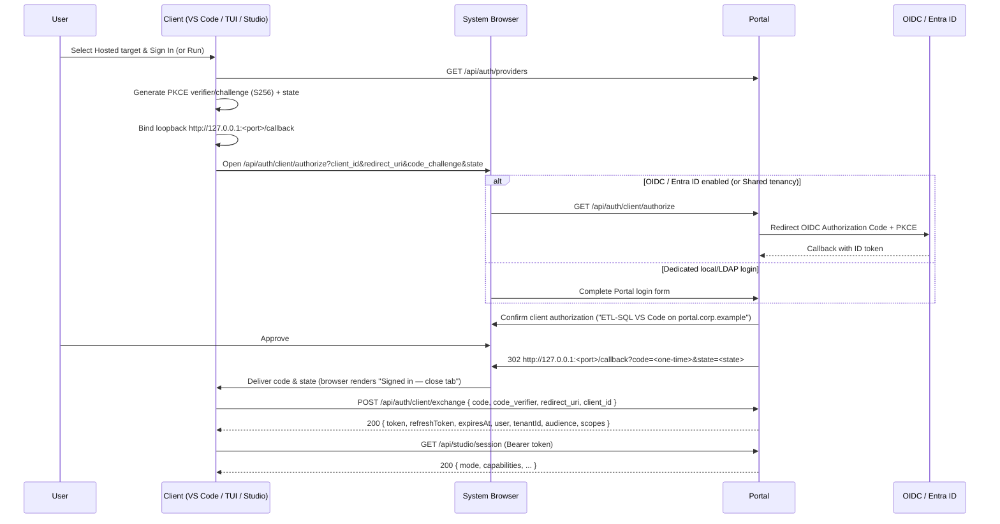

# Hosted Client Sign-In and Execution Contract

**Status:** Proposed for the next release (ST55). First implementation target is VS Code (ST56), with
TUI (ST57) and desktop Studio (ST58) reusing the same server contract.

## 1. Current State and Reuse Inventory

### What exists today

- **VS Code execution ([extension.ts](../../../src/etl-sql-vscode/src/extension.ts), [ReplManager.ts](../../../src/etl-sql-vscode/src/ReplManager.ts)).**
  `etlsql.runScript`, `etlsql.runSelection`, and `etlsql.stopScript` run locally only. `ReplManager`
  spawns the local `ETL-SQL` binary with `--perf --json --session <id>`, streams `EngineMessage`
  JSON lines to `ResultsPanel`, and cancels by signalling the child process.
- **VS Code Portal publish ([portalPublishCommand.ts](../../../src/etl-sql-vscode/src/portalPublishCommand.ts)).**
  Prompts for username and password via `showInputBox` and posts directly to `POST /api/auth/login`.
  It cannot sign in to OIDC/Entra ID or Shared-tenancy hosts (where `POST /api/auth/login` returns
  `401 "Use single sign-on for this host"`), stores only an access token in `context.secrets` with a
  hardcoded 55-minute timestamp in `globalState`, never rotates refresh tokens, and has no sign-out.
- **Portal authentication ([AuthController.cs](../../../src/ETL-SQL.Portal/Controllers/AuthController.cs), [OidcController.cs](../../../src/ETL-SQL.Portal/Controllers/OidcController.cs), [TokenService.cs](../../../src/ETL-SQL.Portal/Services/TokenService.cs)).**
  - `GET /api/auth/providers` reports whether OIDC SSO is enabled for the request host (dedicated or
    Shared-tenant via `SharedIdentityAuthorityResolver`).
  - `GET /api/auth/oidc/login` and `GET /api/auth/oidc/callback` complete Authorization Code + PKCE
    + `nonce` + `state` (including Microsoft Entra ID) using an encrypted `HttpOnly` cookie
    (`ETLSQL_OIDC_FLOW`) and hand `{ token, refreshToken, expiresAt }` to the SPA via a same-origin
    JSON data-island (`/js/sso-complete.js`). There is no native-client callback or code exchange.
  - `POST /api/auth/refresh` rotates single-use SHA-256-hashed refresh tokens, revokes the user's
    token family on `REFRESH_TOKEN_REUSE`, and re-resolves group Studio capabilities.
  - `POST /api/auth/logout` calls `SecuritySessionService.InvalidateUserAsync`, revoking all of the
    user's sessions.
  - `TokenService` issues HMAC-SHA256 JWTs with `iss = "etl-sql-portal"`,
    `aud = "etl-sql-portal-api"`, `sub`, `unique_name`, `security_stamp`, `role`,
    `studio_capability`, and `tenant_id`.
- **Portal Studio execution ([DesignerController.cs](../../../src/ETL-SQL.Portal/Controllers/DesignerController.cs), [StudioPipelineRunsController.cs](../../../src/ETL-SQL.Portal/Controllers/StudioPipelineRunsController.cs), [StudioAuthorizationService.cs](../../../src/ETL-SQL.Portal/Services/StudioAuthorizationService.cs)).**
  - `POST /api/designer/run` requires `ScriptRun` and executes a single read-only query inside the
    Portal process (15 s timeout, capped rows, no writes, no native tools).
  - `POST /api/studio/pipelines/{id}/runs`, `GET /api/studio/pipelines/{id}/runs/{runId}`, and
    `POST /api/studio/pipelines/{id}/runs/{runId}/cancel` require the `Designer` module,
    `ScriptRun`, `StudioDeploymentMode` in `{CatalogOnly, SourceControlled}`, folder/report
    `Execute` permission, and an exact saved `version`. The Portal reads the saved revision from
    `IArtifactStorage` and submits it to the connected Orchestrator (`PIPELINE:{id}`) via
    [OrchestratorProxyService.cs](../../../src/ETL-SQL.Portal/Services/OrchestratorProxyService.cs).
- **Federated Orchestrator identity ([OrchestratorAssertionIssuer.cs](../../../src/ETL-SQL.Portal/Services/OrchestratorAssertionIssuer.cs), [JobApiEndpoints.cs](../../../src/ETL-SQL.Orchestrator.Service/JobApiEndpoints.cs)).**
  Portal never forwards its own JWT to the Orchestrator. Instead, `OrchestratorAssertionIssuer`
  mints a short-lived `X-Orchestrator-Identity` assertion carrying `PrincipalKey`, live group
  `PrincipalKey`s and names, tenant, roles, and (for service accounts) scopes. The Orchestrator
  checks per-job `EXECUTE` grants (or `Admin`/`OrchestratorManager` auto-provisioning), runs in its
  sandbox, records durable `historyId` (`runId`) and statement logs, and handles `POST /api/job-runs/{runId}/cancel`.
  See [Pipelines as Portal documents](portal-etl-documents.md) and [Portal architecture](../portal.md#studio-pipeline-runs).

### Reuse vs. new contract

| Concern | Reuse in ST56 | New contract needed |
| :--- | :--- | :--- |
| Host auth discovery | `GET /api/auth/providers` | None |
| Browser OIDC / local login | `OidcController` + `OidcUserProvisioningService` + `AuthController` | Native-client PKCE handoff: `GET /api/auth/client/authorize` + `POST /api/auth/client/exchange` |
| Session renewal | `POST /api/auth/refresh` | None (add `client_id` / bounded client scopes on client-issued tokens) |
| Sign-out | `POST /api/auth/logout` (all sessions) | `POST /api/auth/client/logout` to revoke only this client's refresh token |
| Capability probe | `GET /api/studio/session` | None |
| Pipeline run, poll, cancel | `POST /api/studio/pipelines/{id}/runs`, `GET .../runs/{runId}`, `POST .../runs/{runId}/cancel` | `Idempotency-Key` header on `POST .../runs` + `GET /api/studio/pipelines/{id}/runs/by-request/{key}` for lost-response recovery |
| Orchestrator federation | `OrchestratorAssertionIssuer`, `OrchestratorProxyService`, Orchestrator `/api/scheduled-jobs/{name}/runs` and `/api/job-runs/{id}` | None |

### Initial execution mode: saved server revision vs. raw editor text

Two options exist for the first hosted run in ST56:

- **Option A (recommended): Execute a saved Portal catalog revision** through
  `POST /api/studio/pipelines/{id}/runs`.
- **Option B: Submit raw unsaved editor text** to a new ad-hoc hosted execution endpoint.

| Dimension | Option A: Saved catalog revision | Option B: Raw editor text |
| :--- | :--- | :--- |
| `ScriptIngress` & `SourceControlled` policy | Enforced automatically on save/publish (`ScriptIngress`, `ScriptSave`, `ReportPublish`, `RequireApprovalToPublish`, secret sealing). | Must re-implement ingress, review bypass prevention, and secret-sealing gates for arbitrary write-capable text. |
| Orchestrator grants & sandbox | Reuses `PIPELINE:{id}` job slots, per-job `EXECUTE` grants, sandbox isolation, and durable `historyId` audit trail (`version` + `sha256`). | Needs a new Orchestrator ad-hoc sandbox slot and grant model; no durable document revision to audit. |
| Author ergonomics | Requires linking/saving a local file to a Portal pipeline (or selecting one) before hosted execution. | Zero-setup "F5 on untitled buffer" on a shared server. |
| Risk of running unintended bytes | Explicit `version` check refuses stale opens (`409 stale_revision`). | Unsaved local edits run directly on shared infrastructure without review or version history. |

**Recommendation:** Ship **Option A** for ST56. It honors `StudioDeploymentMode` (`Disabled`,
`CatalogOnly`, `SourceControlled`), `ScriptIngress`, and `RequireApprovalToPublish` with zero new
write-execution surface in the Portal or Orchestrator. When the active editor buffer has unsaved
changes against the linked catalog pipeline, VS Code never silently runs stale server bytes: it
warns the author and offers **Save to Portal & Run** (when the user holds `ScriptSave` and approval
is not required) or **Run Last Saved Revision**. Read-only interactive selection preview can
separately call `POST /api/designer/run` where permitted. Ad-hoc raw-text hosted execution can be
proposed later as an opt-in, server-gated mode for `CatalogOnly` hosts if operators ask for it.

---

## 2. User Workflow (End to End)

### 2.1 Execution target and trusted server selection

- Every client **defaults to `Local (Offline)` on startup** so hosted connections are always
  deliberate — reopening VS Code, TUI, or desktop Studio never silently reconnects to `Prod` from a
  prior day's session.
- The client always displays the active execution target before submission — in VS Code's bottom
  status bar and results header (for example, `ETL-SQL: Local (Offline)` or
  `ETL-SQL: Hosted — Prod (portal.corp.example / tenant-alpha)`). Clicking the status bar item or
  running **Connect** opens the picker of saved environments (`Dev`, `Test`, `Prod`, or separate
  tenants).
- **Saved server list** lives in **user-level** settings (`etlsql.hosted.servers`: friendly label,
  canonical `https://` origin, optional environment tag). Plain `http://` is refused except for
  explicit `localhost` / `127.0.0.1` development hosts.
- Workspace settings (`.vscode/settings.json`) may reference a server **alias** or catalog document
  ID, never register a new URL or auto-trust a host. The client applies a workspace pipeline link
  only when its configured alias matches the selected trusted server. For any other target, the
  client asks the user to select a saved pipeline from that target's catalog.

### 2.2 First-use browser sign-in (including Entra ID SSO)

- **Loopback callback (RFC 8252)** is the cross-client default because VS Code, TUI, and desktop
  Studio can all bind `127.0.0.1` on an ephemeral port (`http://127.0.0.1:<port>/callback`) with a
  2-minute timeout and no custom OS URI scheme registration. Portal validates that `redirect_uri` is
  strictly `http://127.0.0.1:<port>/callback` (or `http://[::1]:<port>/callback`) with no query,
  fragment, or alternate path.
- ST56 requires the browser and client to share the callback loopback interface. Remote VS Code
  sessions that run the extension host on a different machine need a separate callback design.

### 2.3 Session reuse, run, results, Stop, and disconnect

1. **Session reuse while open:** Once connected to a hosted environment, the client keeps the
   access and refresh tokens **in process memory only** for the lifetime of the app window/process.
   If the access token is valid with at least 60 s remaining, subsequent runs reuse it immediately
   with no browser prompt. If expired, the client runs a single-flight `POST /api/auth/client/refresh`,
   replaces the in-memory pair, and stays connected across the work session until the server
   revokes/changes security, the user disconnects, or the app closes.
2. **Run:** The client checks that the linked pipeline document is saved (or prompts **Save to
   Portal & Run** / **Run Last Saved Revision**), mints a UUIDv4 `Idempotency-Key`, and posts
   `POST /api/studio/pipelines/{id}/runs` with `{ version }` and header `Idempotency-Key`.
3. **Status and results:** On `202 Accepted` (`{ runId, pipelineId, version, scriptHash, jobName }`),
   the client records `runId` in `ResultsPanel`, displays host, tenant, `jobName`, and `runId`, and
   polls `GET /api/studio/pipelines/{id}/runs/{runId}` (500 ms backoff to 2 s) until `isTerminal` is
   true, rendering each `statements[]` entry (statement preview, duration, rows processed, failure
   flag) and final status (`SUCCESS`, `FAILED`, `CANCELLED`). Server-Sent Events can be layered onto
   the same `runId` later without changing the submission or cancellation contract.
4. **Stop:** `etlsql.stopScript` sends `POST /api/studio/pipelines/{id}/runs/{runId}/cancel`.
   - `202 Accepted`: UI shows `Cancellation requested for run <runId> — waiting for Orchestrator` and
     continues polling until `GET .../runs/{runId}` reports terminal `CANCELLED` (or `SUCCESS`/
     `FAILED` if it finished first).
   - `409 run_already_finished`: UI refreshes final status and does not claim cancellation.
   - `403 cancel_denied`: UI displays the server refusal and leaves `runId` visible.
5. **Disconnect / Sign out / App close:**
   - Explicit **Disconnect / Sign Out** clears the in-memory tokens first, calls
     `POST /api/auth/client/logout` to revoke only that client's refresh token (leaving browser tabs
     signed in), and returns the target to `Local (Offline)`.
   - Closing VS Code, TUI, or desktop Studio drops the in-memory session and sends a best-effort
     `POST /api/auth/client/logout` on clean shutdown. Reopening the app starts back on
     `Local (Offline)` and reconnects deliberately through the status bar (one click when Entra ID
     SSO is already active in the browser).
   - A separate **Sign Out All Devices** action calls existing `POST /api/auth/logout`.

### 2.4 Expired sessions, unavailable hosts, and offline/local execution

- **Expired or revoked session:** When `POST /api/auth/client/refresh` returns `401` (expired, revoked,
  disabled account, or `REFRESH_TOKEN_REUSE`), the client clears the dead credential, leaves the run
  **pending**, preserves all editor buffers, and offers **Sign In Again** or **Cancel**.
- **Unavailable host or disconnected Orchestrator:** Network failure, timeout, `503 orchestrator_not_connected`,
  or `503 orchestrator_unreachable` leaves the run **pending** with the sanitized diagnostic. The
  client offers **Retry Hosted** or an **explicit** **Switch to Local (Offline)** action. A failed
  hosted run **never** silently falls back to local execution.
- **Offline / local execution:** Selecting `Local (Offline)` runs entirely on the workstation under
  the local OS account using the local `ETL-SQL` binary/REPL, local tool catalog (XT07 owner-account
  boundary), and local secret vault. No Portal URL, network call, or hosted token is touched.

---

## 3. Trust Boundary

### 3.1 Credential lifecycle and storage

- **Obtained:** Via browser authentication + PKCE (`S256`) one-time authorization code (60 s TTL,
  single-use, bound to `client_id`, `redirect_uri`, `code_challenge`, `userId`, `tenantId`). Tokens
  never appear in URLs, query strings, browser history, or shell arguments.
- **Stored (in-memory session only):**
  - Access and refresh tokens live strictly **in process memory** inside the VS Code extension host,
    TUI process, or desktop Studio `.NET` host process (never in browser `localStorage` /
    `sessionStorage`).
  - Nothing is written to disk across restarts — no persisted refresh tokens in `SecretStorage`, OS
    keychains, `.etlsql`/`.rptsql` files, `.vscode/settings.json`, `globalState`, output channels,
    crash reports, or diagnostic logs. Only the non-secret saved server list (label + HTTPS URL)
    persists in user settings.
- **Refreshed:** Single-flight `POST /api/auth/client/refresh` keeps the active session connected while the
  app stays open. Concurrent requests share one refresh promise so two calls never present the same
  single-use refresh token and trigger native refresh-family revocation.
- **Cleared:** Zeroed/dropped from memory on disconnect, app close, account disable, or
  unrecoverable `401`, and revoked on the server via `POST /api/auth/client/logout` (single token)
  or `POST /api/auth/logout` (all sessions).

### 3.2 Server verification (caller, tenant, audience, scopes)

- **Portal token verification:** Existing JWT validation verifies HMAC-SHA256 signature (key ring),
  `iss = "etl-sql-portal"`, `aud = "etl-sql-portal-api"`, lifetime, `security_stamp`, `IsActive`,
  and `tenant_id` via `TenantCredentialBinding` (fail-closed on Shared tenancy).
- **Client-session scope ceiling:** Native access tokens use `aud = "etl-sql-portal-native-api"`.
  Portal validates the tenant, active user security stamp, and durable native session on each
  authenticated request. Tokens issued by `POST /api/auth/client/exchange`
  carry `client_id` (e.g. `etlsql-vscode`, `etlsql-tui`, `etlsql-studio`) and bounded
  client scopes (`studio.read`, `studio.run`, `studio.save`) rather than implicit Portal
  administration authority. A stolen workstation token cannot call `/api/admin/*` user, role,
  secret-store, or policy endpoints.
- **Federated Orchestrator handoff:** Portal never forwards the client's Portal JWT to the
  Orchestrator. `OrchestratorAssertionIssuer` mints `X-Orchestrator-Identity` with
  `aud = "etl-sql-orchestrator"`, 5-minute TTL, immutable `PrincipalKey`, live group
  `PrincipalKey`s/names, and verified `tenant_id`.

### 3.3 Independent authorization checks

Every hosted run passes independent checks across boundaries:

1. **Submission authorization (Portal + Orchestrator):**
   - Portal checks `StudioAccess`, `ScriptRun`, `StudioDeploymentMode`, tenant partition, document
     `Execute` ACL, and saved `version`.
   - Orchestrator verifies `X-Orchestrator-Identity` and checks the caller's `EXECUTE` grant on
     `PIPELINE:{id}` (or `Admin`/`OrchestratorManager` auto-provision).
2. **Shared connection authorization (`SHARED:alias`, execution host):**
   - When the script executes `CREATE CONNECTION ... SHARED:alias`, the execution host's governed
     connection catalog verifies the caller's per-connection grant before resolving `SECRET:name`
     references. Raw credentials never leave the execution host or appear in client responses.
3. **External tool authorization (future XT07, execution host):**
   - When the script invokes `EXECUTE TOOL alias`, XT07 evaluates explicit per-tool `Use` grants
     against the verified `ExecutionIdentity` (`PrincipalKey`, tenant, group IDs) independently of
     pipeline submission and connection grants. Having `EXECUTE` on `PIPELINE:{id}` and `Use` on
     `SHARED:SalesReadOnly` never implies permission to invoke an ungranted tool.
4. **Script-level `PORTAL` connector authentication (strictly separate):**
   - `CREATE CONNECTION p AS PORTAL(...)` inside a script ([PORTAL connector](../../reference/connectors/services/portal.md))
     authenticates its own administrative API calls using its declared credentials (`PASSWORD` /
     `AUTH_TOKEN` / service account, resolved via `SECRET:` on governed hosts). The client's hosted
     sign-in session is **never** injected into a script's `PORTAL` connector.

### 3.4 Lost submission response and duplicate-run prevention

If the network drops after `POST /api/studio/pipelines/{id}/runs` is sent and before the client
receives `202 Accepted`:

1. **Client sends `Idempotency-Key: <uuid-v4>`** on every submission.
2. **Portal records the key** in a tenant-and-user-scoped table (`StudioRunIdempotency`, 24-hour
   TTL) keyed by `(TenantId, UserId, PipelineId, IdempotencyKey)` with state `Pending` ->
   `Accepted(RunId, ScriptHash, Version)` or `Unknown` if the dispatch could not be confirmed.
   Only the request that owns the claim can finalize it. The Portal checks the bytes against the
   saved revision's hash before dispatch and checks that the acceptance receipt names that script and job.
3. **Recovery without duplicates:**
   - The client displays `Submission unconfirmed (request <key>)` and does **not** claim failure or
     mint a new key.
   - The client queries `GET /api/studio/pipelines/{id}/runs/by-request/{key}` (or retries
     `POST .../runs` with the **same** `Idempotency-Key` and `version`).
   - `Accepted`: Portal returns the existing `{ runId, pipelineId, version, scriptHash, jobName }`
     with `replayed: true`; client attaches to `GET .../runs/{runId}`.
   - `404 submission_not_found`: Portal has no visible receipt. The client offers an explicit retry
     with the original key and revision within the 24-hour recovery window.
   - `Pending` or `Unknown` (`409 submission_outcome_unknown`): Portal has no confirmed receipt.
     A same-key lookup can recover a receipt if the original request later completes. During the
     recovery window the Portal refuses a duplicate dispatch. Inspect recent runs for `PIPELINE:{id}`
     before starting a new run.

---

## 4. ST56 Acceptance Fixture and Client Reuse

### 4.1 Concrete ST56 acceptance fixture (VS Code)

- **Runner topology:** Loopback Kestrel Portal (`StudioAuthoringFixture`) connected to a real
  loopback Federated Orchestrator (`JobApiEndpoints` with `IdentitySigningSecret` enabled) and a
  loopback mock OIDC IdP simulating Entra ID (PKCE `S256`, `tid`, `oid`, `groups` claims).
- **Identity setup (`tenant-alpha`):**
  - `alice`: `Publisher`, member of `DataAuthors` (`StudioAccess`, `ScriptRead`, `ScriptRun`,
    `ScriptSave`), `Author` on `/Finance`, Orchestrator `EXECUTE` grant on `PIPELINE:{id}`, `Use`
    grant on `SHARED:SalesReadOnly`.
  - `bob`: `Publisher`, member of `DataReaders` (`StudioAccess`, `ScriptRead`, `ScriptRun`),
    `Execute` on `/Finance`, **no** Orchestrator `EXECUTE` grant on `PIPELINE:{id}`.
  - Second tenant `tenant-beta` (or a restricted folder) holding a same-named pipeline to confirm
    host/tenant isolation.
- **Fixture scripts:**
  - `FinanceCheck.etlsql`: saved catalog pipeline using `MOCKDB` / `SHARED:SalesReadOnly` with a
    deterministic `SELECT` + `ASSERT` output.
  - `SlowWait.etlsql`: saved catalog pipeline containing `WAITFOR DELAY '00:00:40';` for Stop.

| Step | Action | APIs exercised | Expected result |
| :--- | :--- | :--- | :--- |
| 1. First sign-in | Start on `Local (Offline)`, click Connect, pick Hosted target, sign in via loopback browser OIDC as `alice` | `GET /api/auth/providers`, `GET /api/auth/client/authorize`, `POST /api/auth/client/exchange`, `GET /api/studio/session` | Session held in process memory only; status bar shows host + `tenant-alpha` + `alice`; zero tokens on disk, in settings, or in logs |
| 2. Authorized run | Run `FinanceCheck.etlsql` (`version = 1`) | `POST /api/studio/pipelines/{id}/runs` (`Idempotency-Key`), `GET .../runs/{runId}` | `202` with `runId`; polls to `SUCCESS`; statement metrics rendered; `PIPELINE_RUN_SUBMITTED` audited |
| 3. Session reuse | Run `FinanceCheck.etlsql` a second time | `POST /api/studio/pipelines/{id}/runs`, `GET .../runs/{runId}` | Zero browser launches; same in-memory session reused; second distinct `runId` completes |
| 4. Denied run | Sign in as `bob`, attempt to run `FinanceCheck.etlsql` | `POST /api/studio/pipelines/{id}/runs` | `403 run_grant_denied`; zero Orchestrator execution; clear explanation of missing job grant |
| 5. Session expiry | (a) Expire `alice`'s access token -> run; (b) revoke `alice`'s refresh token -> run | `POST /api/auth/client/refresh`, `POST /api/studio/pipelines/{id}/runs` | (a) Silent single-flight refresh succeeds; (b) `401` leaves run pending, prompts **Sign In Again**, preserves dirty buffer, does **not** run locally |
| 6. Stop | Run `SlowWait.etlsql` as `alice`, invoke `etlsql.stopScript` | `POST .../runs`, `POST .../runs/{runId}/cancel`, `GET .../runs/{runId}` | `202` cancel accepted; polls to terminal `CANCELLED`; `runId` retained; `PIPELINE_RUN_CANCEL_REQUESTED` audited |
| 7. Lost response | Drop `202` response after Portal accepts `Idempotency-Key: K1`, recover | `POST .../runs` (dropped), `GET .../runs/by-request/K1`, `GET .../runs/{runId}` | Client recovers exact `runId`; Orchestrator history contains exactly **one** run for `K1` |
| 8. Disconnect & offline | Disconnect `alice` (and verify clean restart defaults to `Local`), stop Portal, run local script | `POST /api/auth/client/logout`, local `ReplManager` | In-memory session cleared; server refresh token revoked; fresh startup defaults to `Local (Offline)` and runs locally offline under OS account |

- **Evidence to retain:** Automated Portal + Orchestrator + VS Code test run logs, sanitized HTTP
  transcript of steps 1–8, Portal audit rows (`CLIENT_LOGIN`, `PIPELINE_RUN_SUBMITTED`,
  `PIPELINE_RUN_CANCEL_REQUESTED`, `LOGOUT`), Orchestrator history rows confirming single execution
  for `K1` and `CANCELLED` for Stop, and log-hygiene assertion confirming no JWT or refresh token
  strings appear in VS Code output channels or workspace files.

### 4.2 Reuse by TUI (ST57) and Desktop Studio (ST58)

- **Shared server contract (100% reused):** `/api/auth/providers`, `/api/auth/client/authorize`,
  `/api/auth/client/exchange`, `/api/auth/client/refresh`, `/api/auth/client/logout`,
  `/api/studio/session`, `/api/studio/pipelines/{id}/runs` (with `Idempotency-Key`),
  `/api/studio/pipelines/{id}/runs/by-request/{key}`, `/api/studio/pipelines/{id}/runs/{runId}`, and
  `/api/studio/pipelines/{id}/runs/{runId}/cancel`.
- **Shared .NET client library for ST57 + ST58:** TUI (`ETL-SQL.TUI`) and Desktop Studio
  (`ETL-SQL.WorkstationEditor`) can share one small .NET `HostedClientSessionService` (saved server
  list, loopback `HttpListener`, PKCE `S256`, in-memory session state cleared on close,
  single-flight refresh, and `Idempotency-Key` run client). Only the UI affordances (TUI status
  bar/picker vs. Desktop Studio workbench target bar) differ.

---

## 5. Proposed ST56 Scope, Estimate, and Open Decisions

### ST56 implementation slices and estimate

| Slice | Scope | Estimate |
| :--- | :--- | :--- |
| 1. Portal native-client auth handoff | `GET /api/auth/client/authorize`, `POST /api/auth/client/exchange`, `POST /api/auth/client/refresh`, `POST /api/auth/client/logout`, PKCE `S256` + loopback validation, bounded client scopes, audit events, Portal unit/integration tests | 2–3 engineering days |
| 2. Idempotent run submission & recovery | `Idempotency-Key` support on `POST /api/studio/pipelines/{id}/runs`, `StudioRunIdempotency` persistence (SQLite + Postgres migration), `GET .../by-request/{key}`, Portal + Orchestrator tests | 1–2 engineering days |
| 3. VS Code hosted execution & fixture | Saved server list, in-memory session manager (defaulting to Local on startup and revoking on close), loopback browser sign-in, status-bar target picker, saved-revision link/save-and-run prompt, `ResultsPanel` polling + Stop, full ST56 acceptance fixture | 2–3 engineering days |
| **Total (ST56)** | End-to-end VS Code hosted sign-in, execution, Stop, lost-response recovery, and offline local path | **5–8 engineering days** |

### Decisions requiring owner approval before coding

1. **Saved catalog revision as the initial ST56 execution path** (Option A) vs. adding a new
   raw-editor-text hosted runner endpoint (Option B).
2. **Bounded client scopes** (`studio.read`, `studio.run`, `studio.save`) on tokens minted via
   `POST /api/auth/client/exchange` so workstation tokens cannot call `/api/admin/*`, vs. issuing
   the full interactive browser JWT.
3. **Single-session logout** (`POST /api/auth/client/logout` revoking only the client's refresh
   token) vs. reusing `POST /api/auth/logout` (which revokes all browser and client sessions for
   the user).
4. **Loopback-only callback** (`http://127.0.0.1:<port>/callback`) for ST56 vs. also supporting
   VS Code's custom URI handler (`vscode://...`) in ST56 for remote/SSH/Codespaces users.
5. **Migration scope for `StudioRunIdempotency`:** Persist idempotency keys in the Portal DB
   (survives Portal restart, rolling-expand additive table) vs. in-memory cache only (simpler,
   loses recovery across a Portal restart).
